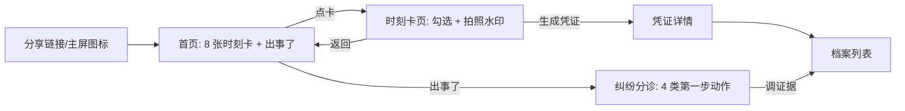
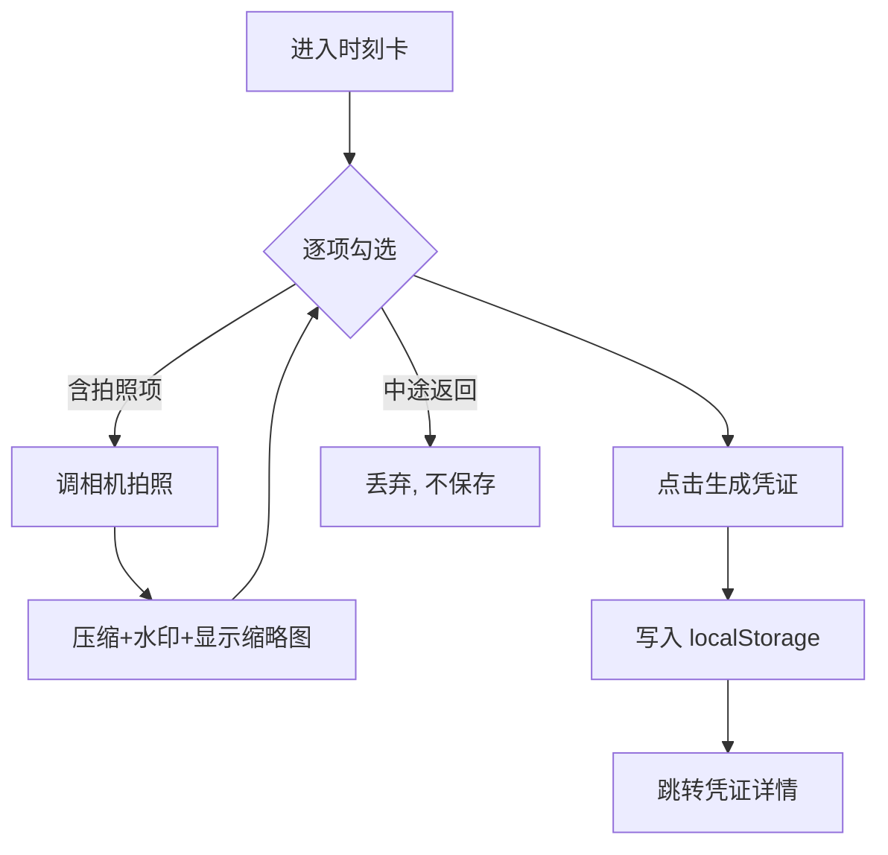

# Memo PRD V0.1

| 版本 | 日期 | 修订人 | 备注 |
|---|---|---|---|
| V0.1 | 2026-11-02 | 产品（对话收敛稿） | MVP 范围：单文件 H5/PWA，住店/租车/打车 6 张时刻卡 |
| V0.2 | 2026-11-02 | 产品 | 新增公交场景（上车/下车 2 张卡），6→8 张；出事了·遗失物增加公交找回路径 |
| V0.3 | 2026-11-02 | 产品 | 修复"主屏（standalone）模式无法刷新"：页头刷新按钮 + network-first Service Worker，同步落地离线优先 |
| V0.4 | 2026-11-02 | 产品 | 刷新可感知：点击「⟳」旋转一圈（0.45s）后重载，避免"点了没反应"的错觉 |

---

## 一、概述（为什么做）

### 1.1 背景介绍

用户在"人生关键事件"（住店、租车、打车、退租等）的入场/离场时刻，普遍面临三类损失：**遗留物品**（充电器、证件）、**押金/车损纠纷无凭据**、**安全焦虑**（针孔摄像头、车牌核验）。现有替代方案：裸拍照（无时间戳效力、三个月后找不到、缺项）、平台客服仲裁（证据不足常败）、什么都不做。竞品格局已确认（详见 2026-11-02 竞品分析）：取证存证赛道（权利卫士/保全网）不懂场景，垂直巡检赛道（Damage iD/Truepic/RentCheck）服务商家立场，通用清单赛道（滴答清单）无留证——**"站在用户立场、按场景驱动的时刻留证工具"为空白**。

### 1.2 产品概述

Memo（暂名）是一个无需注册、打开即用的 H5/PWA：用户在关键时刻打开对应"**时刻卡**"，按 5 项以内的动作清单勾选执行，关键动作内嵌**带时间水印的拍照留证**，完成后自动生成可导出的**凭证**并归档为个人**档案**；出纠纷时走"**出事了**"通道，从档案直接调取材料。

产品哲学：**清单是入口，留证是价值，凭证是资产。** 动作卡内容为纯数据（JSON），渲染层与内容引擎分离，为后续多端（小程序/App/白标）复用打基础。

### 1.3 产品目标

- 业务目标（V0 验证期，上线后 4 周内）：
  - G1：验证"关键时刻打开"——单次会话完成至少 1 张时刻卡的比例 ≥ 60%
  - G2：验证"留证价值感知"——生成凭证后 7 天内再次打开的比例 ≥ 15%
  - G3：内容分享回流——链接分享带来的新会话占比 ≥ 20%
- 用户目标：
  - U1：60 秒内完成一次"此刻该做什么"的检查
  - U2：带走一份带时间水印、可出示的凭证
  - U3：出事时 3 步内拿到材料包

### 1.4 目标用户

- 主要：20–40 岁出行人群（差旅、旅游、租房），单角色，无登录
- 次要（V1+）：中小酒店/民宿（白标）；被纠纷困扰的租客/租客转介绍用户

### 1.5 名词说明

| 名词 | 定义 |
|---|---|
| 时刻卡 | 一个场景时刻（如"退房前 2 分钟"）对应的动作清单页 |
| 动作项 | 时刻卡内的一行动词开头的任务，可含必拍照片 |
| 凭证 | 时刻卡勾选完成后生成的结构化记录（含清单勾选状态 + 水印照片） |
| 档案 | 凭证的归档列表（个人 Memo 的 V0 形态） |
| 出事了通道 | 纠纷分诊页：按纠纷类型给第一步动作并关联历史凭证 |

### 1.6 角色及权限

单一角色：访客用户（无登录、无账号体系）。V0 无权限分级。

### 1.7 文档阅读对象

开发、测试、产品设计。

---

## 二、产品描述（做什么）

### 2.1 产品需求描述

一句话：给用户一个"关键时刻打开 → 60 秒做完 → 带走凭证"的工具，用最低门槛验证两个假设：关键时刻打开率、留证付费意愿。

### 2.2 产品整体流程



数据流：所有数据（凭证、照片）仅存于设备 localStorage；V0 无后端、无上传。

### 2.3 全局说明

- **离线优先**：核心功能不依赖网络。注册 Service Worker（`sw.js`，network-first 策略）：有网时每次打开取最新版本并更新缓存，断网时回退缓存；依赖 HTTPS 环境（GitHub Pages 满足），HTTP 环境自动跳过注册。微信内置浏览器打开时提示"用 Safari/浏览器打开以获得完整体验"（右上角 ··· → 在浏览器中打开）。
- **刷新能力**：standalone（主屏图标）模式下无浏览器刷新按钮，页头右侧常驻「⟳」按钮；点击后按钮旋转一圈（0.45s）再执行重载，保证操作可感知且取到新版。
- **隐私红线**：照片与记录不上传任何服务器；删除档案为物理删除；页面底部固定一行隐私声明"数据仅保存在本机"。
- **全局返回**：所有子页面顶部有返回按钮；iOS 侧滑返回由浏览器原生支持。
- **存储配额**：localStorage 约 5MB，照片压缩至 ≤200KB/张（最长边 1280px、JPEG 质量 0.6）；配额超限时提示并引导删除最旧档案。

### 2.4 产品版本规划

| 版本 | 范围 | 状态 |
|---|---|---|
| V0（本 PRD） | 单文件 H5/PWA：8 张时刻卡（住店/租车/打车/公交）、水印拍照、凭证档案、出事了分诊、主屏引导 | 开发中 |
| V1 | 事件时间轴（事件→节点→卡）、微信服务号触达、云端加密备份（付费）、埋点 | 规划 |
| V2 | Memo 台账（押金总账/纠纷记录/到期日历）、订阅付费、8–10 类人生事件库 | 规划 |
| V3 | 小程序壳（分享裂变/桌牌扫码）、B 端白标试点 | 规划 |

### 2.5 产品框架

```
内容引擎（SCENES/INCIDENTS 纯数据，平台无关）
    ↓
视图层（hash 路由 4 页：首页 / 时刻卡 / 档案 / 出事了）
    ↓
平台：iOS Safari / Android Chrome / 微信内置浏览器（降级）
```

### 2.6 功能清单

| 编号 | 功能 | 优先级 |
|---|---|---|
| F1 | 首页（时刻卡九宫格入口） | P0 |
| F2 | 时刻卡页（勾选 + 水印拍照 + 生成凭证） | P0 |
| F3 | 档案页（列表/详情/导出/删除） | P0 |
| F4 | 出事了页（分诊 + 关联凭证） | P0 |
| F5 | 添加到主屏幕引导 | P0 |
| F6 | 分享回流参数（deeplink 直开某张卡） | P1 |

---

## 三、功能需求（怎么做）

### F1 首页

- **用户故事**：作为用户，我打开页面后 1 秒内看到所有场景入口并点进当下时刻，以便立刻开始检查。
- **前置条件**：无（首次打开即用）。
- **后置条件**：进入时刻卡页或出事了页。
- **界面及交互**：
  - 顶部：产品名 Memo + 隐私声明一行
  - 中部：8 张时刻卡，按场景分组（🏨 住店 ×2 / 🚗 租车 ×2 / 🚕 打车 ×2 / 🚌 公交 ×2），卡片显示场景 emoji、卡标题、副标题、未完成状态
  - 底部固定：两个按钮——「⚠️ 出事了」「📁 我的档案」（档案按钮带数量角标）
  - 首次访问且非主屏环境时，顶部展示"添加到主屏幕"引导条（见 F5），可关闭（记忆 7 天）
- **异常/分支**：
  - 微信内置浏览器：顶部黄色提示条"建议用 Safari 打开（右上角 ··· → 在浏览器中打开）"
  - 无已存凭证：档案按钮正常显示，进档案页显示空态文案
- **数据**：静态渲染 SCENES，无用户数据依赖

### F2 时刻卡页

- **用户故事**：作为用户，我在一张卡上从上到下勾选动作、对关键项拍照留证，点"生成凭证"后带走一份记录，以便离场后有权可维。
- **前置条件**：从首页进入某场景卡。
- **后置条件**：生成凭证写入 localStorage 并跳转凭证详情；或中途返回不保存任何数据。
- **界面及交互**：
  - 卡头：场景 emoji + 标题 + 副标题
  - 动作项列表：每项左侧方形勾选框（点整行切换），动词开头的一行文案；含拍照的项在文案右侧显示「📷 拍照」按钮
  - ⓘ 按钮：点开折叠显示"为什么"（1–2 句依据），默认收起
  - 底部主按钮：「✅ 生成凭证」；次按钮「返回」（不保存）
  - 拍照交互：点击📷 → 调起系统相机（`<input type="file" accept="image/*" capture="environment">`）→ 选/拍后自动压缩并叠加水印（产品名 + 场景名 + 日期时间，白字带黑描边于左下角）→ 显示缩略图，可重拍（覆盖）
- **业务流程**：



- **异常/分支**：
  - 用户拒绝相机/相册权限：该项仍可勾选完成，缩略图位置显示"未拍照"灰字（不阻塞流程）
  - 存储配额超限（QuotaExceededError）：toast 提示"存储空间不足，请到档案删除旧记录"，本次不写入、页面不崩
  - 照片加载失败（FileReader error）：toast"照片读取失败，请重拍"，勾选状态保留
- **数据字典——动作项（内存结构）**：

| 字段 | 类型 | 必填 | 说明 | 示例 |
|---|---|---|---|---|
| t | string | 是 | 动作文案，动词开头 | 充电器、数据线、护照 |
| ph | boolean | 是 | 是否要求拍照 | true |
| why | string | 否 | ⓘ 展开的依据说明 | 最高频遗失物，退房前扫一眼 |

- **数据字典——场景卡（内存结构）**：

| 字段 | 类型 | 必填 | 说明 | 示例 |
|---|---|---|---|---|
| id | string | 是 | 唯一标识，路由用 | hotel-out |
| cat | string | 是 | 场景分组 | 🏨 住店 |
| title | string | 是 | 卡标题 | 退房前 2 分钟 |
| sub | string | 是 | 副标题 | 别落下东西，押金别被乱扣 |
| items | array | 是 | 动作项数组，3–5 项 | 见上文 |

### F3 档案页

- **用户故事**：作为用户，我能在档案里找到过去生成的所有凭证、查看详情并导出文本，以便纠纷时拿得出证据。
- **前置条件**：已生成至少 0 条凭证（空态允许）。
- **后置条件**：查看/删除凭证；复制导出文本。
- **界面及交互**：
  - 列表：按时间倒序，每条显示场景 emoji、卡标题、生成时间、照片数；点进详情
  - 详情：凭证元信息（场景/时间）+ 动作项勾选清单 + 水印照片九宫格（点开大图）+ 两个按钮「📋 复制为文本」「🗑 删除」
  - 导出文本格式：`Memo 凭证\n场景：{title}\n时间：{YYYY-MM-DD HH:mm}\n清单：\n✅ {item}\n☐ {item}\n照片：{n} 张（见本机档案）`
  - 删除：二次确认弹窗，确认后物理删除
- **异常/分支**：空态显示"还没有凭证，去首页开始第一张卡"+ 引导按钮；复制失败降级为选中可手抄文本
- **数据字典——凭证（localStorage: memo.records.v1，数组）**：

| 字段 | 类型 | 必填 | 说明 | 示例 |
|---|---|---|---|---|
| id | string | 是 | 唯一 id（时间戳+随机） | r1698835200000x7 |
| sceneId | string | 是 | 所属场景卡 id | hotel-out |
| ts | number | 是 | 生成时间戳 | 1698835200000 |
| items | array | 是 | [{t, done, photo?}]，photo 为压缩后 dataURL | — |

### F2.1 时刻卡内容全量清单（V0.2，8 张）

| 卡 id | 分组 | 标题 | 动作项 | 拍照项 |
|---|---|---|---|---|
| hotel-in | 🏨 住店 | 进房 60 秒安检 | 5 | 1（找红点） |
| hotel-out | 🏨 住店 | 退房前 2 分钟 | 4 | 2（房间四角/押金条） |
| car-in | 🚗 租车 | 提车 5 分钟 | 5 | 3（绕车/划痕/油表里程） |
| car-out | 🚗 租车 | 还车前 3 分钟 | 4 | 2（绕车/加油小票） |
| taxi-in | 🚕 打车 | 上车 10 秒 | 3 | 0 |
| taxi-out | 🚕 打车 | 下车前 3 秒 | 3 | 1（行程单） |
| bus-in | 🚌 公交 | 上车 10 秒 | 4 | 1（车牌/车身编号） |
| bus-out | 🚌 公交 | 下车前 3 秒 | 4 | 0 |

公交场景要点：公交无实名行程，**车牌/车身编号照片 + 时间是失物找回的唯一线索**（bus-in 唯一拍照项）；下车卡覆盖坐过站、遗失物（手机/雨伞为公交遗失物前两名）、扣费异常当场截图、车走再过马路（电动车盲区）。

### F4 出事了页

- **用户故事**：作为出了纠纷的用户，我需要立刻知道第一步做什么、并用上之前留的证据，以便不慌不亏。
- **前置条件**：无。
- **后置条件**：按分诊执行动作；或跳转档案调取凭证。
- **界面及交互**：4 类纠纷入口（押金被乱扣 / 东西落下了 / 车损争议 / 人身安全），每类点开后显示 3–5 步"第一步做什么"动作列表 + 「📁 打开相关档案」按钮（按场景类别过滤档案）。"东西落下了"覆盖打车/酒店/**公交**三条找回路径（公交：凭 Memo 里的车牌照片打车队电话或 12345 登记失物）。
- **异常/分支**：无相关档案时按钮置灰并显示"本次没有留证，按以下步骤走"；安全类顶部固定提示"紧急情况先打 110/120，再回来用工具"。

### F5 添加到主屏幕引导

- **用户故事**：作为用户，我想把这个工具放到主屏，以便关键时刻 1 秒打开。
- **交互**：iOS Safari（非 standalone）显示顶部引导条"📤 分享 → 添加到主屏幕，关键时刻 1 秒打开"，右侧"×"关闭（localStorage 记忆 7 天）；Android Chrome 检测 beforeinstallprompt 事件则显示"安装"按钮；微信内置浏览器显示"右上角 ··· → 收藏/浮窗"替代文案。
- **异常**：已 standalone（window.navigator.standalone 或 display-mode=standalone）则不显示。

### F6 分享回流（P1）

- 卡片支持 URL 直达：`?c=hotel-out` 或 hash `#/c/hotel-out` 打开即进入对应时刻卡；首页各卡提供"分享此卡"（复制带参链接）。
- **异常**：非法场景 id → 回落首页。

---

## 四、非功能需求

### 4.1 安全与合规

- 数据仅存本机 localStorage，**不采集、不上传任何用户数据**（V0 无后端，页面底部固定声明）
- 照片含水印时间，篡改难度提升；V0 不做哈希/时间戳认证（V1 接可信时间戳，见版本规划）
- 无 Cookie、无第三方统计脚本

### 4.2 统计需求（埋点）

- V0 无后端，不埋点。V1 接入后首批事件：`card_open`（场景id、来源 deeplink/首页）、`card_complete`（场景id、完成项数、照片数）、`record_export`、`sos_open`（纠纷类型）、`install_prompt_result`。[假设：V1 上线时一并定义事件命名规范]

### 4.3 性能需求

- 首屏可交互 < 1s（单文件 < 80KB，无外部依赖）
- 照片处理（压缩+水印）< 800ms/张（1280px 输入）
- localStorage 读写失败不得阻塞页面渲染

### 4.4 数据库设计

- 无数据库。localStorage 两键：`memo.records.v1`（凭证数组，见 F3 数据字典）、`memo.prefs.v1`（引导条关闭时间等偏好）。

### 4.5 系统集成

- V0 无外部依赖。V1 预留：可信时间戳 API（按次）、微信服务号模板消息、云存储（加密后）。V0 的 SCENES 数据结构即为 V1 内容引擎 API 的契约。

---

## 五、附录

### 5.1 验收标准与测试要点

| # | 验收条件 |
|---|---|
| 1 | iPhone Safari 打开 URL，1 秒内可交互；"添加到主屏幕"后图标打开为全屏无浏览器栏 |
| 2 | 8 张时刻卡全部可走通：勾选、拍照（水印含时间）、生成凭证、档案可查 |
| 3 | 关闭页面重开，凭证仍在；飞行模式下全流程可用（不含新增拍照走相册选图） |
| 4 | 拒绝相机权限后流程不断；配额超限有引导不崩溃 |
| 5 | 复制为文本内容完整（场景/时间/勾选清单/照片数） |
| 6 | 出事了 4 类各有步骤且能联动档案过滤 |
| 7 | 微信内置浏览器打开出现降级提示条，主流程不阻断 |
| 8 | 删除凭证后 localStorage 对应数据物理清除 |
| 9 | 主屏图标模式：页头有刷新按钮，点击取到最新版；断网时全流程可用（Service Worker 缓存回退） |

---

## 待确认项清单

### 必须确认（阻塞开发）
1. [假设] V0 不做位置水印（GPS 定位需 HTTPS + 权限，增加复杂度）→ 建议按此执行，见 F2
2. [假设] 照片配额策略：每张 ≤200KB、总配额接近上限时仅提示不自动删除 → 见 2.3/4.3

### 建议确认（影响完整度）
3. [待确认] 出事了 4 类纠纷的具体步骤文案需法务/常识复核 → 见 F4（已按常识预填）
4. [待确认] 是否需要浅色/深色主题跟随系统 → 建议 V0 仅浅色

### 可后续补充
5. [待确认] 埋点事件命名规范与上报通道（V1）→ 见 4.2
6. [假设] 首发场景仅为 8 张出行卡；退租/续保等事件类 V1 接入 → 见 2.4
